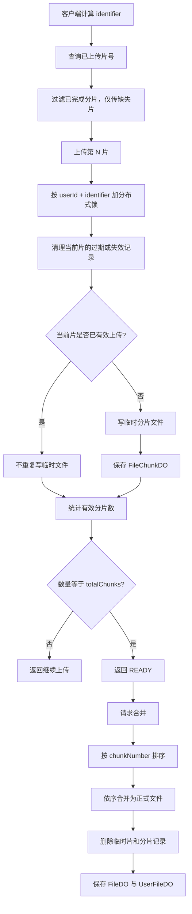

# 文件模块：业务流程与设计说明

## 1. 模块职责与核心模型

文件模块的 HTTP 入口在 `networkdisk-business/networkdisk-files/.../controller/UserFileController.java`，核心业务编排在 `UserFileServiceImpl`。存储能力通过 `networkdisk-common/networkdisk-file` 中的 `StorageEngine` 抽象，当前默认实现为 `LocalStorageEngine`。

这个模块有意将“真实文件”和“用户目录中的文件”拆开保存：

| 模型 | 主要字段 | 解决的问题 |
| --- | --- | --- |
| `FileDO` | `realPath`、`identifier`、大小、后缀、预览 MIME | 管理真实字节和存储位置 |
| `UserFileDO` | `userId`、`parentId`、`realFileId`、文件名、目录标记 | 管理用户可见目录、命名、权限和文件夹层级 |
| `FileChunkDO` | `identifier`、片号、临时路径、过期时间、创建用户 | 管理未合并的临时上传状态 |

因此，同一真实文件可以有多个用户目录项：秒传、复制等业务通常只需创建新的 `UserFileDO`，不必复制文件字节。

```text
FileDO（真实文件）  <── realFileId ──  UserFileDO（用户目录项）
       │                                      │
       └─ realPath                             └─ parentId，构成目录树
```

## 2. 上传方式如何协同

所有上传路径最终都要创建用户目录项；区别在于取得 `FileDO` 的方式。

```text
选择文件
  ├─ 秒传命中       → 复用已有 FileDO       → 创建 UserFileDO
  ├─ 单文件上传     → 写物理文件、创建 FileDO → 创建 UserFileDO
  └─ 分片上传并合并 → 合并物理文件、创建 FileDO → 创建 UserFileDO
```

### 2.1 秒传：先检查是否能复用已上传文件

接口为 `POST /api/v1/files/file/sec-upload`。`UserFileServiceImpl.secUpload` 使用“当前用户 + `identifier`”查询已有 `FileDO`：

```java
List<FileDO> fileList = getFilesByUserIdAndIdentifier(
        context.getUserId(), context.getIdentifier());
if (EmptyUtil.isEmpty(fileList)) {
    return false;
}
FileDO record = fileList.get(0);
saveUserFile(..., record.getId(), ...);
```

`identifier` 由客户端的文件 MD5 提供。命中时不接收文件字节，直接用已有 `FileDO.id` 创建目录项；未命中时客户端继续走上传流程。

这样设计解决了用户重复上传同一文件时的网络、时间和存储浪费。当前是**用户级去重**，而非全站去重：查询带 `create_user`，避免跨用户复用带来的访问边界和信息泄漏问题。

### 2.2 单文件上传：适合小文件或不需要断点续传的场景

接口为 `POST /api/v1/files/file/upload`。调用链：

```text
UserFileController.upload
  → UserFileServiceImpl.upload（事务）
    → saveFile
      → FileServiceImpl.saveFile
        → StorageEngine.store
        → 保存 FileDO
    → saveUserFile
      → 保存 UserFileDO
```

存储引擎统一定义 `store`、`storeChunk`、`mergeFile`、`realFile` 等操作。`LocalStorageEngine.doStore` 把上传输入流写进按日期和 UUID 生成的真实路径；更换为 OSS、FastDFS 时，上层业务无需改动。

单文件上传的设计目的，是为简单上传提供一条无需切片、无需状态管理的直接路径。

> 当前实现注意：`FileServiceImpl.storeMultipartFile` 已创建 `StoreFileContext`，但未调用 `storageEngine.store(storeFileContext)`，应补上该调用，否则 `realPath` 可能为空。这是当前待修复项，详见 `03-future-optimizations.md`。

### 2.3 分片上传：支持大文件、重试和断点续传

接口为：

- `GET /file/chunk-upload`：查询已上传片号；
- `POST /file/chunk-upload`：上传单片；
- `POST /file/merge`：全部完成后合并。

每片带有 `identifier`、`totalChunks`、`chunkNumber`、当前片大小、总大小和文件流。



`UserFileServiceImpl.chunkUpload` 上的 `@DistributeLock(scene = "FILE_CHUNK_UPLOAD", keyExpression = "#context.userId + '-' + #context.identifier")` 将同一个用户上传同一文件的临界区串行化。否则并发请求可能同时判断某片不存在，然后重复写盘或触发唯一键冲突。

`FileChunkServiceImpl.saveChunkFile` 的顺序具有明确目的：

1. **清理无效记录**：过期或逻辑删除的旧记录不能占用同一片的唯一键。
2. **检查该片是否已成功上传**：网络超时后的重试不应重复写磁盘，保证接口幂等。
3. **先写临时物理片，再写 `FileChunkDO`**：数据库记录只在真实分片存在时才表示成功，避免“数据库成功、磁盘不存在”。
4. **按有效片数判断 READY**：片可能并发、乱序到达，不能只根据“最后一片”判断能否合并。

### 2.4 分片合并：把临时状态变为正式可用文件

`FileServiceImpl.doMergeFileChunk` 查询同一用户和 `identifier` 下未过期的 `FileChunkDO`，按 `chunkNumber` 升序取出 `realPath`，再调用 `storageEngine.mergeFile`。

排序不可省略：客户端上传可乱序，数据库查询也没有默认顺序。若按无序路径拼接，得到的文件大小可能正确，但字节顺序已经损坏。

本地实现 `LocalStorageEngine.doMergeFile` 依次追加各分片到最终路径，并删除临时文件。合并成功后：

1. 物理删除相应 `FileChunkDO`；
2. 保存最终 `FileDO`；
3. 保存指向该 `FileDO` 的 `UserFileDO`。

这样未合并的临时上传不会显示在用户文件列表中，用户看到的文件均可下载或预览。

## 3. 下载与预览：同一读取链路，不同响应策略

下载和预览分别对应 `/file/download` 与 `/file/preview`。共同流程为：

```text
UserFileDO
  → 校验文件存在、属于当前用户、不是文件夹
  → 根据 realFileId 查询 FileDO
  → 取得 realPath
  → response.getOutputStream()
  → StorageEngine.realFile()
```

区别仅在 HTTP 响应头：

| 场景 | Content-Type | Content-Disposition | 效果 |
| --- | --- | --- | --- |
| 下载 | `application/octet-stream` | `attachment`，并附带编码后的文件名 | 浏览器保存文件 |
| 预览 | `FileDO.filePreviewContentType` | 不设置 attachment | 浏览器按 MIME 类型展示 |

服务端流式输出避免将整个文件装入 JVM 内存，尤其适合大文件；也让本地、OSS、FastDFS 等存储实现共享同一读取协议。当前本地实现使用 `FileChannel.transferTo` 写入响应输出流。

## 4. 目录树、复制和移动

### 4.1 目录树

`getFolderTree` 一次查出当前用户所有未删除目录，再在内存中构造树：

1. 将每条目录记录映射为 `FolderTreeNodeVO`；
2. 按 `parentId` 分组；
3. 将 `parentId == node.id` 的节点加入其 `children`；
4. 返回 `parentId == TOP_PARENT_ID` 的根节点。

该方案避免递归查询导致的 N+1 SQL 问题，单次查询、内存 O(n) 构树，适合用于移动/复制目标目录选择器。

### 4.2 防止移动或复制到自身子目录

移动和复制都必须阻止以下结构：将 `A` 放到 `A/B` 中。移动会产生目录环；复制会在递归拷贝子节点时无限增长。

`checkIsChildFolder` 的做法是：

1. 从待操作记录中取出文件夹；
2. 查询该用户所有有效文件夹，并按 `parentId` 建邻接表；
3. 递归找到每个源文件夹的全部子孙；
4. 得到不可选集合：源目录自身 + 全部子孙目录；
5. 若目标目录 ID 在集合中，拒绝操作。

移动只更新根节点 `parentId`；复制则为根节点和全部子节点生成新 ID、重建父子关系。两者均通过 `handleDuplicateFilename` 解决目标目录重名问题。
