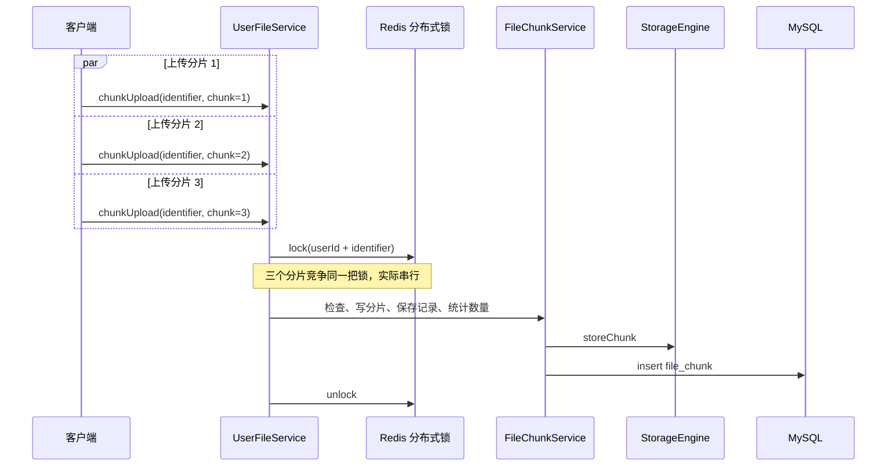
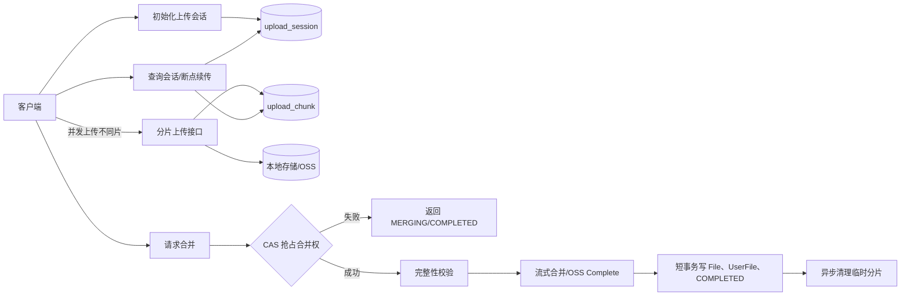
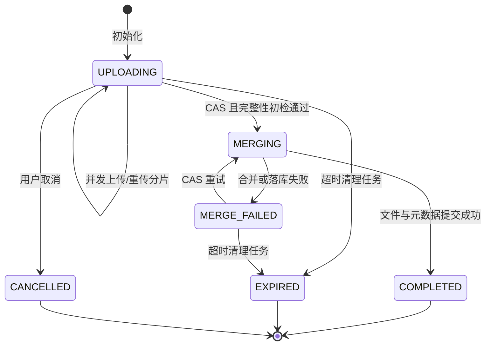
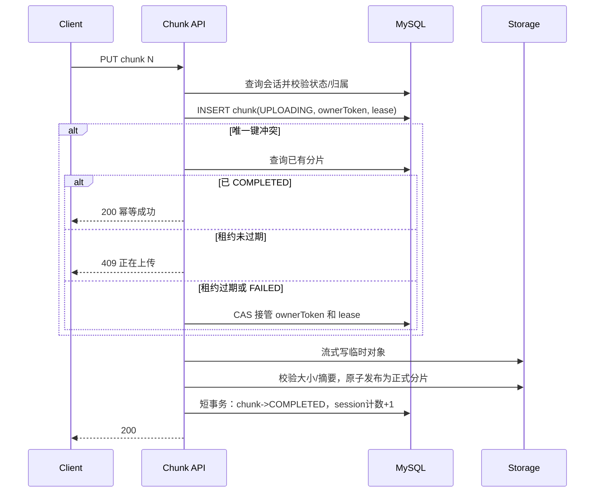

# 分片上传高并发改造设计

> 文档状态：设计稿  
> 适用模块：`networkdisk-business/networkdisk-files`、`networkdisk-common/networkdisk-file`、`disk-by-cursor`  
> 技术基线：Java 21、Spring Boot 3.2、MySQL、Redis/Redisson、本地文件系统或 OSS  
> 更新时间：2026-10-24

## 1. 背景与结论

当前客户端最多同时上传 3 个分片，但服务端 `UserFileServiceImpl.chunkUpload` 使用
`(userId, identifier)` 作为分布式锁键。一个文件的所有分片共享同一把锁，因此客户端并发请求到达服务端后仍会被串行执行。

当前合并接口还存在以下风险：

- 合并没有并发控制，重复请求可能同时生成多个真实文件和用户文件记录；
- 合并只检查“存在分片”，没有校验分片数量、片号连续性、分片大小之和和文件摘要；
- 物理文件合并、`file` 落库、`user_file` 落库和临时分片删除之间没有可靠的失败恢复边界；
- 当前客户端生成的 `identifier` 是“文件名、大小、修改时间”的 32 位字符串哈希，不是文件内容摘要，存在碰撞和错误复用风险；
- 本地存储合并时逐片调用 `Files.readAllBytes`，并发合并大文件时容易形成明显的堆内存峰值；
- OSS 存储的 `doStoreChunk` 也锁住了同一文件的全部分片，未发挥 OSS Multipart Upload 的并发能力。

本次改造采用以下核心原则：

1. **分片之间不加文件级全局锁**，允许同一文件的不同分片真正并行上传；
2. **数据库唯一约束保证一片只有一个有效结果**，应用层幂等逻辑改善体验，但不作为最终正确性边界；
3. **合并通过数据库 CAS 状态迁移选出唯一执行者**，Redis 锁不是正确性的唯一依赖；
4. **文件流 I/O 不占用长事务**，数据库事务只负责短时间的状态变更；
5. **临时分片在正式文件提交成功前不删除**，失败后可以重试和补偿；
6. **对上传、合并分别实施背压**，避免用无限线程或无限队列把压力转移到磁盘、对象存储和数据库。

## 2. 改造目标与非目标

### 2.1 目标

- 同一上传会话的不同分片可以并发写入；
- 同一分片被重复提交时接口幂等，不重复占用有效存储；
- 多个合并请求并发到达时最多一个请求执行合并；
- 服务端自行判断是否满足合并条件，不信任客户端的 READY 状态；
- 进程在关键步骤崩溃后，任务能够重试、接管或由清理任务补偿；
- 支持断点续传，并能准确返回会话状态和已完成片号；
- 本地存储和 OSS 共用统一的业务状态模型；
- 可以通过指标、日志、压测和故障注入证明改造效果。

### 2.2 非目标

- 本阶段不实现跨用户全站秒传；
- 本阶段不处理文件下载和预览的高并发问题；
- 第一阶段不强制把同步合并改成 MQ 异步合并，但会预留状态和接口语义；
- 不通过扩大通用线程池制造表面 QPS；并发上限必须服从磁盘、网络、数据库连接池和 OSS 限额。

## 3. 当前链路与问题定位

### 3.1 当前链路



### 3.2 主要竞态

| 场景 | 当前风险 | 目标处理方式 |
| --- | --- | --- |
| 不同片并发上传 | 文件级锁导致串行 | 不共享锁，并行写入 |
| 同一片重复上传 | “先查后写”存在竞态 | 唯一索引 + 分片占有租约 |
| 重复合并 | 可能重复合并、重复落库 | 会话状态 CAS，单赢家 |
| 提前合并 | 可能合并不完整文件 | 服务端校验片数、片号、大小、摘要 |
| 写存储后进程崩溃 | 可能留下孤儿分片 | 确定性路径/租约接管/定时清理 |
| 合并后数据库失败 | 可能留下孤儿正式文件 | 记录合并结果并由补偿任务删除或恢复提交 |
| 数据库成功后清理失败 | 临时分片残留 | COMPLETED 后异步幂等清理 |
| 客户端重复初始化 | 产生多个相同会话 | `clientRequestId` 唯一约束 |

## 4. 总体架构

引入“上传会话”作为并发控制和恢复的聚合根。`identifier` 仅表示文件内容摘要，服务端生成的 `uploadId` 才是一次上传任务的唯一身份。



### 4.1 核心不变量

任何实现都必须保持以下不变量：

1. 一个 `uploadId` 只属于一个用户，所有查询和变更都必须同时限定 `uploadId + userId`；
2. 一个会话的一个 `chunkNumber` 最多只有一条有效记录；
3. 分片标记为 `COMPLETED` 时，对应物理分片必须存在且大小正确；
4. 只有全部分片完整时才能从 `UPLOADING` 进入 `MERGING`；
5. 一个上传会话最多生成一个 `FileDO` 和一个 `UserFileDO`；
6. `COMPLETED` 是终态，重复完成请求必须返回第一次的结果；
7. 正式文件数据库事务提交前，临时分片不能删除；
8. `uploaded_chunks`、`uploaded_bytes` 是快速判断用的计数器，合并前仍须以分片明细复核。

## 5. 上传会话状态机

建议状态如下：

| 状态 | 含义 | 允许操作 |
| --- | --- | --- |
| `UPLOADING` | 正在接收分片 | 上传、查询、请求完成 |
| `MERGING` | 已有执行者获得合并权 | 查询；重复完成请求返回处理中 |
| `COMPLETED` | 正式文件及用户文件记录已提交 | 查询；重复完成请求返回原结果 |
| `MERGE_FAILED` | 合并失败但分片仍可用 | 查询、重新请求完成 |
| `EXPIRED` | 会话过期 | 只查询，不再接受上传 |
| `CANCELLED` | 用户主动取消 | 只查询，等待或完成清理 |



`MERGING` 必须带租约字段。执行者进程崩溃后，其他实例只能在租约到期后通过 CAS 接管，不能永久卡住。

## 6. 数据模型

### 6.1 `upload_session`

以下是目标结构示例，最终字段长度应结合现有数据库规范调整：

```sql
CREATE TABLE upload_session (
    id                  BIGINT       NOT NULL,
    upload_id           VARCHAR(64)  NOT NULL COMMENT '服务端生成的公开会话ID',
    client_request_id   VARCHAR(64)  NOT NULL COMMENT '客户端初始化幂等键',
    user_id             BIGINT       NOT NULL,
    identifier          VARCHAR(128) NOT NULL COMMENT '文件内容SHA-256',
    filename            VARCHAR(255) NOT NULL,
    parent_id           BIGINT       NOT NULL,
    total_size          BIGINT       NOT NULL,
    chunk_size          BIGINT       NOT NULL,
    total_chunks        INT          NOT NULL,
    uploaded_chunks     INT          NOT NULL DEFAULT 0,
    uploaded_bytes      BIGINT       NOT NULL DEFAULT 0,
    status              TINYINT      NOT NULL,
    storage_type        VARCHAR(16)  NOT NULL,
    storage_upload_id   VARCHAR(256) NULL COMMENT '例如OSS multipart uploadId',
    final_path          VARCHAR(1024) NULL,
    real_file_id        BIGINT       NULL,
    user_file_id        BIGINT       NULL,
    merge_owner         VARCHAR(64)  NULL,
    merge_lease_until   DATETIME(3)  NULL,
    expiration_time     DATETIME(3)  NOT NULL,
    last_error          VARCHAR(1024) NULL,
    lock_version        INT          NOT NULL DEFAULT 0,
    gmt_create          DATETIME(3)  NOT NULL,
    gmt_modified        DATETIME(3)  NOT NULL,
    PRIMARY KEY (id),
    UNIQUE KEY uk_upload_id (upload_id),
    UNIQUE KEY uk_user_request (user_id, client_request_id),
    KEY idx_user_identifier (user_id, identifier),
    KEY idx_status_expiration (status, expiration_time)
) ENGINE=InnoDB;
```

设计说明：

- `uploadId` 使用不可预测的 UUID/随机 ID，不暴露自增主键；
- `clientRequestId` 由客户端为一次“创建上传任务”生成 UUID，网络重试时保持不变；
- 同一内容上传到不同目录可以创建不同会话，因此不对 `(userId, identifier)` 建唯一约束；
- OSS 的 Multipart `uploadId` 持久化在会话中，不再仅依赖 Redis 缓存；
- `lockVersion` 用于状态迁移和租约接管 CAS。

### 6.2 `upload_chunk`

```sql
CREATE TABLE upload_chunk (
    id                  BIGINT        NOT NULL,
    session_id          BIGINT        NOT NULL,
    chunk_number        INT           NOT NULL,
    expected_size       BIGINT        NOT NULL,
    actual_size         BIGINT        NULL,
    chunk_hash          VARCHAR(128)  NULL,
    storage_path        VARCHAR(1024) NULL,
    storage_etag        VARCHAR(256)  NULL,
    status              TINYINT       NOT NULL,
    owner_token         VARCHAR(64)   NULL,
    lease_until         DATETIME(3)   NULL,
    last_error          VARCHAR(1024) NULL,
    lock_version        INT           NOT NULL DEFAULT 0,
    gmt_create          DATETIME(3)   NOT NULL,
    gmt_modified        DATETIME(3)   NOT NULL,
    PRIMARY KEY (id),
    UNIQUE KEY uk_session_chunk (session_id, chunk_number),
    KEY idx_session_status (session_id, status),
    KEY idx_lease (status, lease_until)
) ENGINE=InnoDB;
```

分片状态只需要：

- `UPLOADING`：某个请求获得了该片的写入租约；
- `COMPLETED`：物理片已校验并可参与合并；
- `FAILED`：本次写入失败，可以重新抢占。

不建议继续把逻辑删除字段放进分片唯一键。临时记录以状态和生命周期管理，清理时物理删除即可。

## 7. 接口设计

建议新增 v2 接口，旧接口在迁移期作为适配层保留。

### 7.1 初始化上传

```http
POST /api/v2/files/upload-sessions
Content-Type: application/json
```

```json
{
  "clientRequestId": "98ea5821-66f2-4ef5-82bf-fb52925113c8",
  "filename": "demo.zip",
  "parentId": "encrypted-parent-id",
  "identifier": "sha256:...",
  "totalSize": 524288000,
  "chunkSize": 8388608,
  "totalChunks": 63
}
```

响应：

```json
{
  "uploadId": "upl_2f51...",
  "status": "UPLOADING",
  "uploadedChunks": [],
  "recommendedConcurrency": 3,
  "expiresAt": "2026-10-25T14:30:00+08:00"
}
```

服务端必须校验：

- `totalChunks == ceil(totalSize / chunkSize)`；
- `chunkNumber` 范围为 `[1, totalChunks]`；
- 非最后一片的期望大小等于 `chunkSize`，最后一片等于余数；
- 文件大小、片大小、片数均不超过配置上限；
- 父目录属于当前用户且有效；
- 当前用户未超过“活跃上传会话数”和容量配额。

相同 `(userId, clientRequestId)` 重试时直接返回已有会话。

### 7.2 上传分片

```http
PUT /api/v2/files/upload-sessions/{uploadId}/chunks/{chunkNumber}
Content-Type: application/octet-stream
X-Chunk-SHA256: optional-sha256
```

响应语义：

- 首次成功：`200 COMPLETED`；
- 该片已经成功：`200 COMPLETED`，`idempotentHit=true`；
- 该片正被另一个请求上传：`409 CHUNK_UPLOADING`，携带建议重试时间；
- 会话正在合并或已完成：`409 SESSION_NOT_UPLOADABLE`；
- 服务端繁忙：`429/503`，携带 `Retry-After`；
- 参数或摘要不一致：`400`，客户端不应自动重试。

### 7.3 查询会话

```http
GET /api/v2/files/upload-sessions/{uploadId}
```

返回状态、已完成片号、已上传字节、过期时间；完成后同时返回加密后的 `userFileId`。

查询结果必须来自数据库。Redis 可以缓存结果，但不能成为上传状态的唯一事实来源。

### 7.4 请求完成

```http
POST /api/v2/files/upload-sessions/{uploadId}/complete
```

推荐响应：

- 抢占成功并同步合并完成：`200 COMPLETED`；
- 已有执行者正在合并：`202 MERGING`；
- 已经完成：`200 COMPLETED`，返回第一次生成的 `userFileId`；
- 分片不完整：`409 CHUNKS_INCOMPLETE`，返回缺失片号；
- 合并任务达到并发上限：`429/503`，会话保持可重试状态。

接口响应码应统一，不再由前端分别判断字符串 `SUCCESS` 和数字 `200`。

## 8. 分片上传并发算法

### 8.1 请求处理步骤



### 8.2 为什么需要分片租约

只有唯一索引仍不能完整解决“写存储后进程崩溃”：数据库可能残留一条正在处理的记录。租约允许另一个请求在超时后接管。

租约规则：

- 每次占有分片生成随机 `ownerToken`；
- 完成更新必须带 `WHERE owner_token = ? AND status = UPLOADING`；
- 租约时间覆盖正常单片上传耗时，并允许上传过程中续租；
- 接管使用 `lock_version` 或条件更新时间进行 CAS；
- 旧执行者即使迟到，也无法覆盖新执行者结果。

### 8.3 本地存储写入规则

建议路径：

```text
chunks/{userId}/{uploadId}/{chunkNumber}.part
chunks/{userId}/{uploadId}/tmp/{chunkNumber}.{ownerToken}.tmp
```

流程：

1. 每个请求只写自己的 `.tmp` 文件；
2. 流式写入并统计实际字节数，可选同时计算 SHA-256；
3. 校验成功后原子移动为 `{chunkNumber}.part`；
4. 数据库将分片置为 `COMPLETED`；
5. 失败时删除当前请求的临时文件，不影响其他片。

确定性正式分片路径使崩溃恢复更简单。移动必须限制在同一文件系统内，才能尽量使用原子 move。

### 8.4 OSS 写入规则

- 初始化会话时只初始化一次 OSS Multipart Upload，并将 OSS `uploadId` 持久化到 `upload_session`；
- 不再给所有 `uploadPart` 请求加同一把 `(userId, identifier)` 锁；
- 不同 `partNumber` 可以并发调用 `uploadPart`；
- 每片完成后将 `ETag`、大小和摘要写入 `upload_chunk`；
- Complete Multipart Upload 前按 `chunkNumber` 排序组装 part 列表；
- 会话取消或过期时调用 Abort Multipart Upload。

Redis 可以缓存 OSS 会话信息，但缓存丢失时必须能从 MySQL 恢复。

### 8.5 计数器更新

只有分片第一次从非完成态变为 `COMPLETED` 时才增加计数：

```sql
UPDATE upload_chunk
SET status = :completed,
    actual_size = :actualSize,
    storage_path = :path,
    owner_token = NULL,
    lease_until = NULL,
    lock_version = lock_version + 1
WHERE session_id = :sessionId
  AND chunk_number = :chunkNumber
  AND status = :uploading
  AND owner_token = :ownerToken;
```

受影响行数为 1 后，才执行：

```sql
UPDATE upload_session
SET uploaded_chunks = uploaded_chunks + 1,
    uploaded_bytes = uploaded_bytes + :actualSize,
    gmt_modified = CURRENT_TIMESTAMP(3)
WHERE id = :sessionId
  AND status = :uploading;
```

两个更新放在同一个短事务中。不得在上传网络流或写磁盘期间持有数据库事务和连接。

## 9. 合并单赢家算法

### 9.1 抢占合并权

合并前先查询缺失片；完整后执行条件更新：

```sql
UPDATE upload_session
SET status = :merging,
    merge_owner = :instanceId,
    merge_lease_until = DATE_ADD(NOW(3), INTERVAL :leaseSeconds SECOND),
    lock_version = lock_version + 1
WHERE upload_id = :uploadId
  AND user_id = :userId
  AND status IN (:uploading, :mergeFailed)
  AND uploaded_chunks = total_chunks
  AND uploaded_bytes = total_size;
```

只有受影响行数为 1 的请求获得执行权。失败请求查询最新状态：

- `COMPLETED`：返回原有 `userFileId`；
- `MERGING` 且租约有效：返回处理中；
- `MERGING` 但租约过期：使用 `lockVersion` CAS 接管；
- 分片不完整：返回缺失片号。

Redis 分布式锁可以作为减少数据库竞争的优化，但数据库 CAS 和唯一索引必须独立保证正确性。

### 9.2 完整性复核

执行者必须重新读取全部 `COMPLETED` 分片并检查：

- 记录数量等于 `totalChunks`；
- 片号去重后严格为 `1..totalChunks`；
- 每片实际大小符合初始化时计算的期望大小；
- `sum(actual_size) == total_size`；
- 存储对象存在；
- 配置了分片摘要时，每片摘要匹配；
- 合并后文件大小与内容 SHA-256 匹配。

服务端不能因为最后一个上传请求返回 READY 就直接相信客户端可以合并。

### 9.3 本地文件流式合并

当前 `FileUtil.appendWrite` 使用 `Files.readAllBytes`，应改成固定缓冲区或 `FileChannel.transferTo/transferFrom`。合并写入临时正式文件：

```text
files/tmp/{uploadId}.{mergeOwner}.tmp
```

全部校验通过后再原子移动到最终路径。合并过程中不删除源分片。

### 9.4 正式结果提交

物理合并完成后开启短事务：

1. 插入 `FileDO`；
2. 插入 `UserFileDO`；
3. 更新 `upload_session`：`MERGING -> COMPLETED`，保存 `finalPath`、`realFileId`、`userFileId`；
4. 更新条件必须包含当前 `mergeOwner` 和 `MERGING` 状态。

如果事务回滚，正式物理文件进入补偿清理队列；如果事务提交成功，临时分片由异步清理任务删除。重复完成请求直接读取会话中已保存的结果。

## 10. 背压与资源隔离

### 10.1 分片上传限制

至少配置以下限制：

- 单用户活跃上传会话数；
- 单会话同时上传分片数；
- 全实例同时进行的存储写数量；
- 单片大小、总文件大小、最大分片数；
- 按用户/IP 的请求速率和字节速率。

对文件上传仅按 QPS 限流不够准确：1 KB 和 8 MB 的请求成本不同。至少应结合请求体大小实施配额或并发许可。

### 10.2 合并隔离

本地文件合并使用独立的有界执行器或 `Semaphore`，不与普通业务异步任务共用线程池：

```text
corePoolSize = 根据磁盘数量和压测结果设置，初始建议 1~2
maxPoolSize  = 固定为 corePoolSize
queueCapacity = 有界，例如 20
rejection = 快速失败并返回 429/503
```

不建议对合并执行器使用 `CallerRunsPolicy`，否则队列满时会让 HTTP 请求线程执行大文件合并，破坏资源隔离。

Java 21 虚拟线程可以降低阻塞线程成本，但不能增加磁盘吞吐、数据库连接数或 OSS 配额，因此本阶段不把虚拟线程作为主要优化手段。

### 10.3 数据库连接

当前数据源最大连接数为 20。所有存储 I/O 必须发生在事务外，否则并发上传会长时间占用连接池。一次分片请求最多包含：

1. 查询会话；
2. 短事务抢占分片；
3. 存储 I/O；
4. 短事务完成分片并更新计数。

## 11. 客户端改造

当前按批次执行 `Promise.all`：一批中最慢的请求会阻塞下一批。建议改为固定数量的 worker 从共享队列持续取任务。

客户端流程：

1. 使用 Web Worker 增量计算文件 SHA-256，避免阻塞页面主线程；
2. 生成 `clientRequestId` 并初始化上传会话；
3. 根据服务端返回的已完成片号过滤任务；
4. 启动 `recommendedConcurrency` 个 worker 持续取片；
5. 仅对网络错误、`429`、`503` 和部分 `5xx` 指数退避重试，并加入随机抖动；
6. `4xx` 参数错误和摘要不一致不自动重试；
7. 使用 `AbortController` 支持暂停和取消；
8. 全部分片完成后调用 complete，并轮询 `MERGING` 状态直到完成。

初始并发度可以保持 3，不应在没有压测数据时直接提高。后续可根据延迟、失败率和 `Retry-After` 做有限的自适应调整。

## 12. 异常恢复与清理

| 故障点 | 可观察状态 | 恢复方式 |
| --- | --- | --- |
| 抢占分片后、写存储前崩溃 | chunk=UPLOADING，租约过期 | 新请求 CAS 接管 |
| 分片已写、数据库未完成 | 正式片存在，记录未完成 | 接管者校验已有片后完成落库，或覆盖重写 |
| 合并抢占后崩溃 | session=MERGING，租约过期 | 新实例接管 |
| 正式文件生成后、事务前崩溃 | 临时正式文件存在 | 接管者复用校验通过的文件或清理重建 |
| 数据库已完成、分片清理失败 | session=COMPLETED | 后台幂等清理 |
| 会话长期无活动 | expiration_time 到期 | CAS 为 EXPIRED 后清理分片/Abort OSS |

定时任务要求：

- 分页扫描，避免一次加载全部过期记录；
- 多实例通过 CAS 或 `SELECT ... FOR UPDATE SKIP LOCKED` 分工；
- 清理存储成功后再物理删除分片记录；
- 删除失败记录次数、最后错误和下次重试时间；
- 保留死信/人工重试入口，不能无限静默重试。

## 13. 安全与校验

- `uploadId` 必须不可预测，接口不得接受用户传入的内部数据库主键；
- 每次操作都校验当前用户与会话归属；
- 物理路径只能由服务端生成，不能拼接未经处理的文件名；
- 校验声明大小与实际读取字节数，防止绕过配额；
- 限制文件名长度、分片数、分片大小和总文件大小；
- 内容摘要用于完整性和去重提示，不替代病毒扫描和内容安全检查；
- 客户端摘要不能被无条件信任，最终文件摘要应由服务端计算或由可信对象存储校验能力确认。

## 14. 可观测性

所有日志携带 `uploadId`、`userId`、`chunkNumber`、`ownerToken` 或 `mergeOwner`，但不记录文件内容和敏感令牌。

建议指标：

| 指标 | 类型 | 用途 |
| --- | --- | --- |
| `upload_chunk_requests_total{result}` | Counter | 成功、幂等命中、冲突、失败分布 |
| `upload_chunk_duration_seconds{storage}` | Histogram | 分片上传 p50/p95/p99 |
| `upload_chunk_bytes_total` | Counter | 实际上传吞吐 |
| `upload_active_sessions` | Gauge | 活跃会话数量 |
| `upload_chunk_lease_takeover_total` | Counter | 崩溃或超时接管情况 |
| `upload_merge_active` | Gauge | 当前合并数量 |
| `upload_merge_queue_depth` | Gauge | 合并背压状态 |
| `upload_merge_duration_seconds` | Histogram | 合并耗时 |
| `upload_merge_failures_total{stage}` | Counter | 校验、存储、落库失败 |
| `upload_cleanup_pending` | Gauge | 待清理对象数量 |
| `upload_orphan_files_total` | Counter | 补偿发现的孤儿文件 |

告警至少覆盖：合并失败率、清理积压、租约接管突增、磁盘使用率、数据库连接池等待和合并队列持续满载。

## 15. 测试与验收

### 15.1 单元与集成测试

- 同一片并发提交 20 次，最终只有一条 `COMPLETED` 记录；
- 不同片并发提交时不相互等待文件级锁；
- 重复初始化使用同一 `clientRequestId` 返回同一 `uploadId`；
- 缺片、重复片、越界片、大小错误、摘要错误均拒绝合并；
- 20 个完成请求并发执行，只产生一个 `FileDO` 和一个 `UserFileDO`；
- 合并完成后的重复请求返回同一个 `userFileId`；
- 过期租约可以被接管，旧 owner 无法提交结果；
- 数据库回滚后正式临时文件可被补偿；
- 数据库完成后清理失败不影响文件可用性；
- 本地与 OSS 存储实现执行同一套契约测试。

并发测试使用 `CountDownLatch`/`CyclicBarrier` 同时放行请求，并使用 Testcontainers 启动真实 MySQL；不能只用内存数据库模拟唯一索引和事务行为。

### 15.2 故障注入

在以下位置主动终止进程或抛出异常：

1. 分片占有成功后；
2. 物理分片写完后；
3. 分片完成事务提交前后；
4. 合并状态切换后；
5. 正式文件生成后；
6. `FileDO`/`UserFileDO` 事务提交前后；
7. 临时分片清理过程中。

恢复后必须满足核心不变量，且清理任务最终能够消除临时垃圾。

### 15.3 压测场景

分别压测，避免把不同结论混在一起：

- 单用户、单大文件、1/3/5/8 路并发；
- 多用户、不同文件并发上传；
- 同一分片高比例重复请求；
- 上传过程中并发请求完成；
- 大量会话同时进入合并；
- 慢磁盘、慢 OSS、数据库连接池接近上限；
- 服务实例重启后的续传和接管。

记录 QPS、MB/s、p95/p99、错误率、连接池等待、线程数、堆内存、GC、磁盘吞吐、Redis/MySQL 延迟和合并队列深度。

验收标准：

- 正确性测试中重复有效分片、重复正式文件、错误摘要文件均为 0；
- 同一文件不同片不再出现文件级分布式锁等待；
- 并发提升到存储饱和点前，吞吐随并发度有可解释的增长；
- 达到容量上限后系统通过 `429/503` 快速背压，不出现无限排队、OOM 或数据库连接池雪崩；
- 故障恢复后所有会话都能进入可重试终态，孤儿数据在约定清理窗口内归零。

具体吞吐和延迟阈值应在固定硬件、固定片大小下完成基线测试后填写，不能在没有测量时宣称提升倍数。

## 16. 分阶段实施计划

### 阶段 0：修复基线正确性

- 修复单文件上传未调用 `storageEngine.store`；
- 本地合并改为流式复制；
- 合并前补充分片排序、数量、片号和大小校验；
- 为现有行为补充集成测试，保存改造前基线数据。

### 阶段 1：引入上传会话

- 新建 `upload_session`、`upload_chunk`；
- 新增初始化、查询接口；
- 客户端改用 `uploadId`，`identifier` 改成内容 SHA-256；
- 旧 `file_chunk` 暂时只读或通过适配层迁移。

### 阶段 2：放开分片并发

- 移除 `UserFileServiceImpl.chunkUpload` 的文件级分布式锁；
- 移除 OSS `doStoreChunk` 的文件级分布式锁；
- 实现分片唯一索引、owner token、租约和 CAS 接管；
- 接入用户级、会话级和实例级背压。

### 阶段 3：合并幂等与补偿

- 实现合并单赢家 CAS 和租约；
- 在一个数据库事务中提交 `FileDO`、`UserFileDO` 和会话完成状态；
- 增加正式文件补偿与临时分片异步清理；
- complete 接口返回稳定的任务状态和 `userFileId`。

### 阶段 4：异步合并与可观测性

- 压测证明同步合并成为瓶颈后，再改为持久化任务/MQ 异步合并；
- 使用独立有界执行器或消费者组限制合并并发；
- 接入指标、告警、故障注入和容量压测。

## 17. 代码改造落点

| 当前位置 | 改造方向 |
| --- | --- |
| `disk-by-cursor/src/utils/upload.js` | 内容摘要、初始化会话、worker 队列、退避重试、暂停/恢复 |
| `UserFileController` | 新增 v2 初始化、查询、分片和完成接口 |
| `UserFileServiceImpl.chunkUpload` | 移除文件级锁，委托上传会话服务 |
| `FileChunkServiceImpl` | 由“先查后写”改为唯一约束、租约和 CAS |
| `FileServiceImpl.mergeFileChunkAndSaveFile` | 完整性复核、单赢家合并、事务提交和补偿 |
| `LocalStorageEngine` | 临时文件、原子发布、流式合并、提交后清理 |
| `OssStorageEngine` | 持久化 multipart uploadId，允许不同 part 并发，支持 abort |
| `networkdisk-common/networkdisk-lock` | 不再承担分片正确性；仅作为可选竞争优化 |

建议新增：

```text
domain/entity/UploadSessionDO.java
domain/entity/UploadChunkDO.java
domain/service/UploadSessionService.java
domain/service/impl/UploadSessionServiceImpl.java
infrastructure/mapper/UploadSessionMapper.java
infrastructure/mapper/UploadChunkMapper.java
job/ExpiredUploadCleanupJob.java
job/StaleMergeRecoveryJob.java
```

## 18. 面试表述要点

可以按“问题—取舍—验证”讲述：

> 原实现虽然客户端并发上传三个分片，但服务端按用户和文件摘要加了文件级分布式锁，实际又把分片串行化。我引入上传会话，把不同分片变成互不共享锁的并发单元，用 `(sessionId, chunkNumber)` 唯一索引和租约保证重复请求幂等；合并阶段则通过数据库 CAS 让一个请求从 UPLOADING 切换到 MERGING，只有赢家执行合并。文件 I/O 全部放在事务外，最终用短事务写入真实文件、用户文件和会话完成状态。对于数据库与物理存储不能组成同一事务的问题，我保留分片到提交成功之后，并用补偿任务处理孤儿文件。最后通过并发重复请求、进程宕机注入和压测验证没有重复合并、损坏文件和无限排队。

这套方案体现的重点不是使用了多少并发工具，而是：锁粒度、幂等边界、状态机、数据库约束、资源背压以及跨存储介质的一致性恢复。
